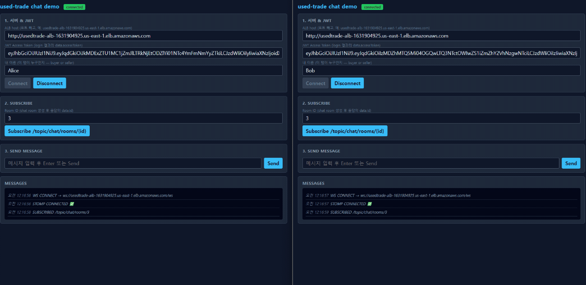
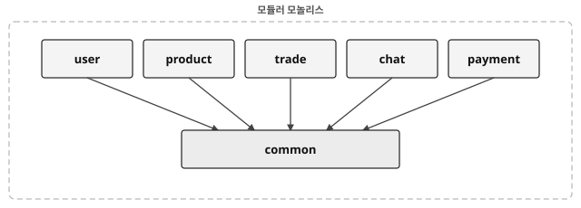
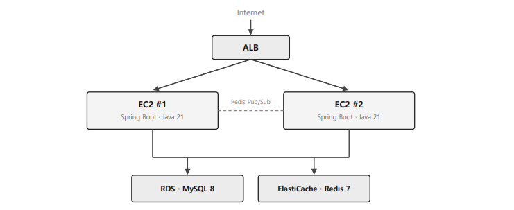

# used-trade

> 모듈러 모놀리스 중고거래 백엔드

<br>



> Redis Pub/Sub 채널을 사용해 멀티 인스턴스 채팅 참여자에게 메시지를 브로드캐스트

<br><br>

## 아키텍처
> 단일 Spring Boot 애플리케이션 + cross-cutting common



<br>



<br><br>

## 기술 스택

| 분류 | 사용 기술 |
|---|---|
| 언어 / 런타임 | Java 21 (Liberica JDK) |
| 프레임워크 | Spring Boot 3.5, Spring Data JPA, Spring Security, Spring WebSocket (STOMP), Spring Retry |
| 데이터 | MySQL 8.0, Redis 7 |
| 인프라 | AWS (EC2 / ALB / RDS / ElastiCache / ECR), Docker, GitHub Actions |
| 빌드 / 테스트 | Gradle, JUnit 5, Mockito, AssertJ, Spring Boot Test |

<br><br>

## 측정 결과

|주제|시나리오|결과|
|---|---|---|
|동시성 제어|동일 상품 N=50 동시 예약|중복 거래 3건 → 0건, p95 193ms|
|커서 페이징|10만 건 중 뒤쪽 페이지 조회|OFFSET 14.40ms → CURSOR 0.71ms (20.1배)|
|멀티 인스턴스 채팅|두 JVM 간 메시지 전달|Redis Pub/Sub로 메시지 일관성 확보|
|Saga 보상 (부분 구현)|PG 결제 실패|trade.cancel + Product 상태 자동 복원|

<br><br>

## 로컬 배포

```bash
cp .env.example .env
docker compose up -d
./gradlew bootRun
```

확인:
```bash
curl http://localhost:8080/api/hello/health-db
```

테스트 / 벤치마크:
```bash
./gradlew test
./gradlew benchmark
```

AWS 배포 : [docs/deploy/aws-setup.md](docs/deploy/aws-setup.md)

<br><br>

## 프로젝트 구조

```
com.portfolio.used_trade/
├── user/      회원 (가입 / 로그인 / refresh / 로그아웃)
├── product/   상품 (CRUD + 커서 페이징)
├── trade/     거래 (낙관적 락 + Saga)
├── chat/      채팅 (STOMP + Redis Pub/Sub)
├── payment/   결제 (Mock PG)
└── common/    config / exception / response / base entity
```

## 문서

**ADR**
- [모듈러 모놀리스](docs/adr/001-modular-monolith.md)
- [낙관적 락](docs/adr/002-optimistic-locking.md)
- [Redis Pub/Sub](docs/adr/003-redis-pubsub-chat.md)
- [커서 페이징](docs/adr/004-cursor-pagination.md)
- [Saga (부분 구현)](docs/adr/005-saga-orchestration.md)
- [AWS 배포 스택](docs/adr/006-aws-stack-choice.md)

**가이드**
- [프로젝트 구조](docs/guides/project-structure.md)
- [테스트 전략](docs/guides/testing-strategy.md)
- [Docker](docs/guides/docker.md)